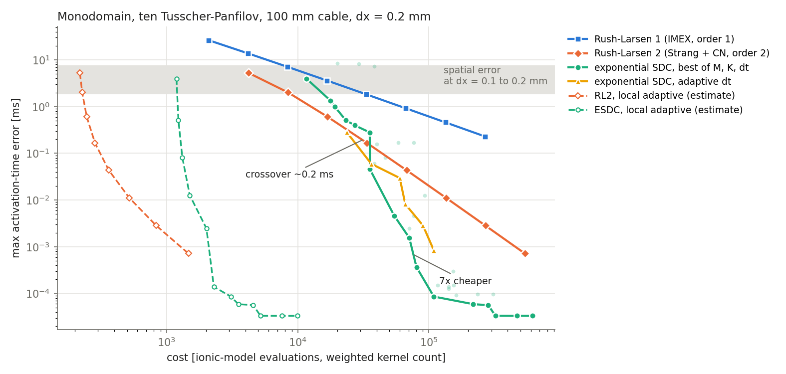
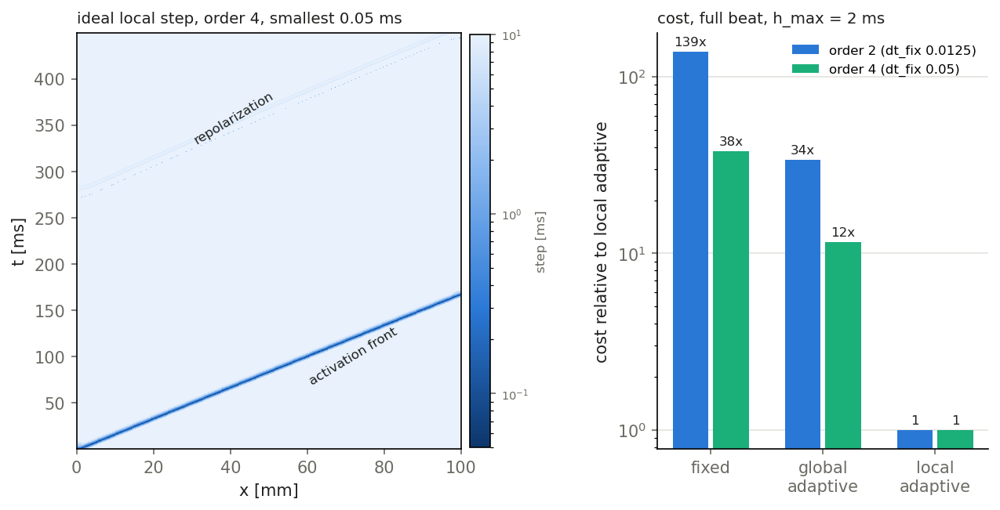

# Follow-up to the stage 1 gate: the stability barrier and local adaptivity

**Short answer.** Stability is not what limits ESDC at the cheap end. The real limit is time resolution of the upstroke.
Local adaptivity is a large lever, with an estimated 10-140x over fixed steps, but it helps the low-order Rush-Larsen
scheme more than ESDC. With local steps, the SDC crossover moves from about 0.2 ms down to about 3e-3 ms of activation
error (or 1e-4 ms with a 2 ms step cap).

## 1. Why ESDC fails at dt >= 0.4 ms, and why fixing that would not help

- **Where it fails.** ESDC diverges in the step that contains the upstroke. The first sweep looks harmless. Then the
  increments in V grow (100, 64, 170 mV) and the next sweep produces NaN. The first variable to leave its physical range
  is the L-type calcium gate d.
- **What drives it.** The sweep treats the coupling between V and the gates explicitly (V -> m_inf(V), lambda(V) -> m ->
  I_Na -> V), and it freezes each gate rate at its step-start value lambda_0. During the upstroke lambda(V) changes
  10-50x, and dI_Na/dm reaches about -320 mV/ms. The potential's own diagonal, df_V/dV, is only about +-0.05/ms. The
  iteration has to contract over the whole step, and dt times the Lipschitz constant of the explicit part rises above
  about 1. Rush-Larsen only has to stay bounded: its gate update is a convex combination, and V lags one step. So RL
  loses accuracy, not stability.
- **Attempted fix (not kept).** I made the block of V and the sodium gates (m, h, j) linearly implicit in the sweep,
  with a finite-difference Jacobian at the step start plus the per-node gate-rate mismatch. It is exact at the fixed
  point (agrees with plain ESDC to 5e-15), but it diverges just like plain ESDC. At the step start m is about 0.006 and
  the coupling is negligible, because the stiffness only appears mid-step. Standard SDC with a node-wise Rush-Larsen
  sweep (the project's `runge_kutta/imexexp_1st_order`) diverges already at dt = 0.05. There exponential Euler cancels
  only about e of the collocation term dt lambda e for stiff gates.
- **Why it would not help anyway.** At dt = 0.2, ESDC is stable and converged (M = 6 gives the same answer for K = 9 and
  K = 12). Yet its collocation error is 0.17 ms (M = 6) or 1.35 ms (M = 3), and those points sit on RL2's
  work-precision front. At dt = 0.4, 3-6 nodes cannot resolve the roughly 0.5 ms upstroke, so even an exact collocation
  solve would be worse than RL2 at equal cost.
- **Away from the upstroke, large steps work.** From 180 ms (fully activated) to 400 ms (plateau and repolarization),
  ESDC is stable at dt = 1 ms (relative V error 4e-4) and dt = 2 ms (2.8e-3). In that window RL2 is still cheaper at
  loose tolerance (4e-4: RL2 1.8k evaluations at dt = 0.25 against 2.9k for ESDC M = 3, K = 4 at dt = 1). ESDC is
  cheaper at tight tolerance (1e-6: RL2 35k against 22k).

## 2. Local (per-cell) adaptivity

- **Method.** I recorded an accurate full beat (450 ms, every 0.025 ms) in float64; a first float32 record had a noise
  floor that capped the order-4 estimate. For an order-p method I take the ideal local step h = (eps /
  |u^(p+1)|)^(1/p) per cell, minimized over V, m, h, d and Ca_i (each scaled by its range). The smallest step is
  calibrated to a working fixed dt, and steps are capped at h_max. Cost is counted in cell-steps. Fixed and global
  adaptive stepping follow from the same field.
- **Bounds over the full beat.**

  | | fixed / local | global / local | fixed / global |
  |---|---|---|---|
  | order 2, dt_fix 0.0125, h_max 2 ms | 139x | 34x | 4x |
  | order 4, dt_fix 0.05, h_max 2 ms | 38x | 12x | 3x |

  Only the cells inside the activation front need small steps; repolarization is a faint second band. Global
  adaptivity can only exploit the time after activation (1.4-4x).
- **Applied to the stage 1 runs.** I divided each run's cost by its gain at its own dt, with order 2 for RL2 and
  order 4 for ESDC (dashed lines in the figure). Both methods drop by one to two orders of magnitude, and RL2 drops
  more:

  | max activation error | RL2 local | ESDC local (h_max 10 ms) | |
  |---|---|---|---|
  | 0.5 ms | ~70 | 319 | RL2 4.5x |
  | 0.045 ms | 199 | 487 | RL2 2.4x |
  | 0.0025 ms | ~700 | 632 | even |
  | 7e-4 ms | 1322 | ~700 | ESDC ~1.9x |

  With h_max = 2 ms (stability tested for both), ESDC wins only below about 1e-4 ms.
- **Mechanism.** With local steps, the cost concentrates in the cells inside the upstroke, and both methods must resolve
  that roughly 0.5 ms upstroke. Higher order narrows the spread between front and quiet steps (step proportional to
  eps^(1/p)), so it gains less from local stepping. It also pays 1 + MK evaluations per step against 2 for RL2.
- **Caveats.** These are upper bounds: an ideal per-cell error estimator, no cost for coupling cells with different
  steps through diffusion, 1D, and an order-4 assumption for ESDC (its observed order is capped by TTP's if-else
  branches).

## Implication for the showcase

Neither lever creates an application regime where serial ESDC beats a fairly treated Rush-Larsen scheme. With fixed
steps, ESDC wins only below about 0.2 ms; with local steps, only below about 3e-3 ms. Both are far below the 2-7 ms
spatial error of realistic meshes. What could still change the balance is the cost per ESDC step at the front: parallel
sweeps across nodes (stage 2: critical path divided by about M), or fewer sweeps per step.
