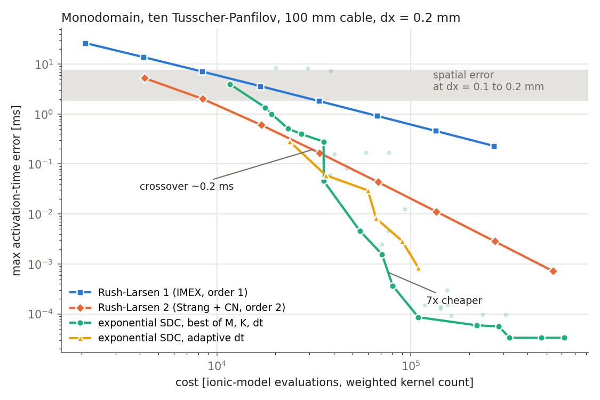

# Stage 1 gate: serial ESDC vs Rush-Larsen

**Verdict: holds partly.** Exponential SDC beats the best community scheme (second-order Rush-Larsen, Strang + CN) for
activation-time errors below about 0.2 ms, by up to 7x at equal accuracy (7e-4 ms) and 50-130x lower error at equal
cost. Above about 0.2 ms RL2 is as cheap or 1.3x cheaper. The crossover sits 10-35x below the spatial error of
realistic meshes, so in the regime practitioners work in, serial ESDC does not win.

## Setup

- 1D cable, 100 mm, dx = 0.2 mm (512 points, 4th-order FD/DCT), ten Tusscher-Panfilov (original, with its
  if-else discontinuities), stimulus at one end, T = 200 ms (front crosses in 167 ms, CV 0.59 mm/ms).
- Cost: counted kernels weighted by their measured cost on the 2D problem, in units of one ionic-model evaluation
  (DCT solve or Laplacian 0.01, field exponential 0.003, lambda-only call 0.37). Ionic calls dominate.
- QoI: activation time (first crossing of -20 mV) at every point; ESDC uses its collocation polynomial as dense
  output, RL linear interpolation between steps.
- Reference: ESDC M = 6, K = 12, dt = 0.01; agrees with dt = 0.005 to 1.1e-5 ms (max).
- 82 runs: RL1, RL2 (both Strang orderings) at 8 step sizes; ESDC M in {3, 4, 6}, K up to 2M, dt 0.025-0.8;
  adaptive ESDC (pySDC `Adaptivity`, 4 tolerances, 2 configurations).

## Front-to-front

| max activation error | RL2 cost | ESDC cost | |
|---|---|---|---|
| 0.6 ms | 17k | ~23k | RL2 1.3x cheaper |
| 0.17 ms | 34k | ~30k | even |
| 0.044 ms | 68k | 36k | ESDC 1.9x |
| 0.011 ms | 135k | ~50k | ESDC 2.7x |
| 0.0028 ms | 270k | ~60k | ESDC 4.5x |
| 0.0007 ms | 540k | ~75k | ESDC 7x |

RL1, the community default, needs 17k evaluations at dt = 0.0125 ms for 3.6 ms; at that cost RL2 gives 0.6 ms and
ESDC about 1 ms.

Spatial error of the activation times: 5.6 ms between dx = 0.2 and 0.1 mm, 22.7 ms between 0.4 and 0.2 (second
order), so about 7 ms at dx = 0.2 and 2 ms at dx = 0.1.

## Mechanism

1. **Stability cap.** ESDC diverges for dt >= 0.4 ms at every M, and M = 6 already degrades at dt = 0.2. The fast
   sodium current is in the explicit part, so the cheapest ESDC point is about 12k evaluations, while RL2 keeps
   going down to 4k.
2. **Cost per step.** One ESDC step costs 1 + M K ionic evaluations (10-25) against 2 for RL2, so ESDC needs a
   5-12x larger step to break even. It only can once the error is small enough for its higher order to pay.
3. **Order cap.** TTP's if-else branches limit the observed order: M = 6 gains only 3x from halving dt = 0.05.
4. **Adaptivity has no quiet phase.** While the front propagates, some point is always in its upstroke, so a global
   dt stays at the upstroke scale; adaptive runs land on or behind the fixed-step front (and restart about half
   their steps).

## Changes to the code base (branch `monodomain-showcase`)

- `sweeper_classes/runge_kutta/rush_larsen.py`: RL1 and RL2 (DRD and RDR Strang) as one-node sweepers;
  `tests/test_monodomain_rush_larsen.py` checks orders 1 and 2.
- `MultiscaleMonodomainODE`: work counters per kernel, optional `stimulus='corner'`.
- ESDC sweeper: phi cache now also keyed on dt (adaptivity restarts reused stale phi), and compares plain arrays
  (`np.allclose` on meshes crashed on NaN via `mesh.__abs__`); counts field exponentials.
- `run_scripts/work_precision.py`: runner, activation-time hook with dense output and progress lines.
