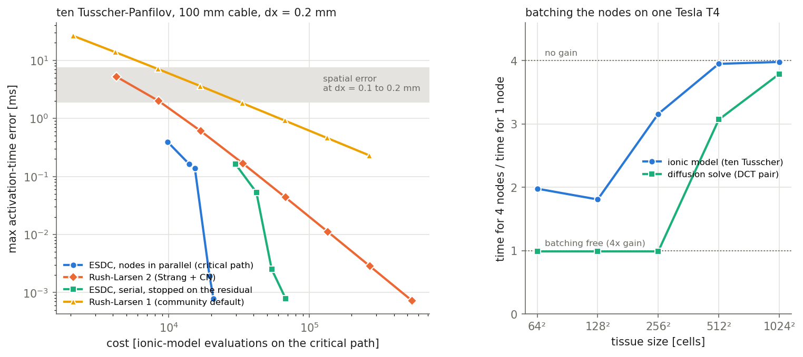

# Stage 2: exponential SDC with the nodes in parallel

**Verdict: on counted work, node-parallel ESDC beats second-order Rush-Larsen at practical accuracy. On real
hardware it does not: one GPU cannot deliver the gain for realistic tissue sizes, and on 4 CPU cores of JUSUF it is
only as fast as RL2 on one, because ESDC's own quadrature costs more than the ionic model the counting assumed
dominant.**

- **Counted on the critical path** (1D cable), node-parallel ESDC is cheaper than RL2 at every accuracy measured. At
  0.4 ms of activation-time error it is 1.7x cheaper, at 0.1 ms 3.5x, at 0.01 ms 14x. The crossover of stage 1
  (0.2 ms, far below what meshes resolve) is gone.
- **On one Tesla T4**, evaluating the ten Tusscher model at 4 nodes costs about 2x one node for small tissue
  (64²-128² cells) and the full 4x from 256² cells on. So a single GPU turns the counted 4x into at most 2x for small
  tissue and into nothing for realistic sizes.
- **The counted gain is real wall-clock gain only with M devices**: time parallelism across the collocation nodes, on
  top of spatial parallelism that has already saturated.

## Terms

- **Activation time**: when the membrane potential first crosses -20 mV at a point. Its largest error over the cable is
  the accuracy measure.
- **RL1 / RL2**: the Rush-Larsen schemes cardiac codes use. The gating variables are updated exactly for frozen rates,
  the rest of the ionic model explicitly, and diffusion implicitly. RL2 is the second-order Strang version with
  Crank-Nicolson diffusion.
- **ESDC**: exponential spectral deferred corrections. It iterates ("sweeps") towards the collocation solution on M
  nodes per step, integrating the gates' linear relaxation exactly.
- **Critical path**: the work that has to happen one after another. In a serial sweep every node waits for the
  previous one. In the node-parallel sweep all M nodes of a sweep are independent, so with M processes a sweep costs
  one node.
- **Cost unit**: one evaluation of the ionic model on all cells, which costs 30-100x a diffusion solve here.

## What changed since stage 1

- **New sweeper** `sweeper_classes/exponential_runge_kutta/imexexp_parallel.py`. Each node is updated from the
  previous iterate only:
  - the collocation integral from the step start is taken at the previous iterate;
  - diffusion gets a diagonal (MIN-SR-S) implicit correction;
  - the explicit ionic terms and the gates' deviation from their step-start rates enter through the integral (a
    Picard update).

  The fixed point is ESDC's collocation solution. `tests/test_monodomain_parallel_esdc.py` checks that it agrees with
  the serial sweep to 1e-8.
- **Stopping on the residual**: both sweeps iterate until the relative collocation residual is below `restol`,
  instead of a fixed number of sweeps. Quiet steps (plateau, rest) then stop after 2-3 sweeps, and only steps with an
  upstroke take many.
- **Convergence is as good as serial.** Over the first 20 ms (front running) at restol 1e-10, the parallel sweep
  needs 8.5 / 13.7 / 26.6 sweeps per step at dt = 0.05 / 0.1 / 0.2, against 8.3 / 14.7 / 36.1 for the serial one.
  The diagonal sweep showed none of the instability feared from the stiff gating.

## Results on the cable (1D, dx = 0.2 mm, T = 200 ms, same reference as stage 1)

Cheapest run reaching a maximum activation error, in ionic evaluations on the critical path:

| max activation error | 1 ms | 0.5 ms | 0.2 ms | 0.1 ms | 0.01 ms | 1e-3 ms |
|---|---|---|---|---|---|---|
| RL2 | 16.9k | 33.8k | 33.8k | 67.6k | 270k | 541k |
| ESDC serial, stopped on the residual | 29.8k | 29.8k | 29.8k | 42.0k | 54.0k | 67.8k |
| ESDC node-parallel (critical path) | 9.8k | 9.8k | 13.9k | 19.5k | 19.5k | 20.8k |
| gain of node-parallel ESDC over RL2 | 1.7x | 3.5x | 2.4x | 3.5x | 14x | 26x |

The cheapest node-parallel run (M = 4, dt = 0.2, restol 1e-5) already reaches 0.39 ms, so its first two entries are
the same run. The counted gain comes from the critical path. In total work over M processes, the node-parallel ESDC
costs about M times as much and is not cheaper than serial ESDC.

## What a GPU makes of it

Measured on a Tesla T4 (Modal). The ten Tusscher right-hand side runs as a CUDA kernel generated from the project's
C++ source (agrees with it to 2e-12), and the diffusion solve is a pair of 2D DCTs:

| tissue | 4 nodes / 1 node, ionic model | 4 nodes / 1 node, DCT pair |
|---|---|---|
| 64² | 1.98 | 0.99 |
| 128² | 1.81 | 0.99 |
| 256² | 3.16 | 0.99 |
| 512² | 3.95 | 3.07 |
| 1024² | 3.98 | 3.79 |

The heavy ionic kernel fills the GPU already at a few thousand cells, so batching the nodes is only half price for
small tissue and full price from 256² on. On one T4, a parallel sweep then costs about 1.9 ionic evaluations instead
of 1. The realized gain over RL2 is the counted gain divided by about 1.9, roughly half, for tissue up to 128². From
256² on, a parallel sweep costs as much as a serial one, and the comparison falls back to the serial-ESDC row: behind
RL2 at 1 ms (0.6x), 1.6x ahead at 0.1 ms.

## 2D spot check

Square tissue (100 mm, 128 x 128 cells, dx = 0.78 mm) with a corner stimulus, T = 250 ms. The reference is
node-parallel ESDC with M = 4, dt = 0.05 and restol 1e-8; on the cable that configuration's collocation error is about
1e-4 ms. On this coarse grid the front is slow and about 70% of the cells activate by 250 ms. Compared are the cells
the reference activates before 245 ms, so that cells activating at the very end do not fall on different sides of T
in different runs.

| run | cost (critical path) | max activation error | mean |
|---|---|---|---|
| ESDC node-parallel, M = 4, dt = 0.2, restol 1e-5 | 13.0k | 0.037 ms | 0.022 ms |
| ESDC node-parallel, M = 4, dt = 0.1, restol 1e-5 | 17.8k | 0.124 ms | 0.066 ms |
| RL2, dt = 0.025 | 21.1k | 0.46 ms | 0.27 ms |
| RL2, dt = 0.0125 | 42.2k | 0.126 ms | 0.073 ms |
| RL2, dt = 0.00625 | 84.5k | 0.032 ms | 0.018 ms |

The cable result holds in 2D:
- at about 0.035 ms, node-parallel ESDC is 6.5x cheaper than RL2, and 2.4x at 0.12 ms;
- against RL2's cheapest run it is 1.6x cheaper and 12x more accurate.

With dt = 0.1 and the same restol, the error is larger than with dt = 0.2. The relative residual tolerance, not the
step, limits that run. The serial ESDC runs were dropped from the 2D check: they took several hours each on this
machine, and the cable already gives the serial comparison.

## Real multi-device run on JUSUF

`sweeper_classes/exponential_runge_kutta/imexexp_parallel_MPI.py` puts one collocation node on each MPI rank. The
integral to node m is reduced onto rank m, and the integral computed for the residual check is reused by the next
sweep. Its final state agrees with the same sweep on one rank to 1e-12. `run_scripts/mpi_timing.py` times the runs.

One JUSUF CPU node (job 906602, 7 minutes, about 15 core-hours at full-node billing), one core per rank, short
windows. RL2 at dt = 0.0125 and node-parallel ESDC (M = 4, dt = 0.1, restol 1e-5) reach about the same activation
error, about 0.12 ms, in the 2D check above:

| case | RL2, 1 core | ESDC serial, 1 core | ESDC parallel, 1 core | ESDC parallel, 4 cores | speedup 1 -> 4 cores | 4-core ESDC vs RL2 |
|---|---|---|---|---|---|---|
| 128², 10 ms | 33.3 s | 56.8 s | 61.1 s | 31.5 s | 1.94 | 1.06x |
| 256², 3 ms | 51.2 s | -- | 101.3 s | 45.5 s | 2.23 | 1.13x |

**On real hardware, node-parallel ESDC on 4 cores is only as fast as RL2 on 1 core.** The counted 3x does not
materialize, for two reasons:

- **ESDC's work is not dominated by the ionic model.** A profile of the node-parallel sweep on 128² (3 ms window)
  attributes 54% of the time to ESDC's collocation integral (`integrate`), 15% to the phi functions set up once per
  step, and only 31% to ionic-model evaluations. The counting model of stages 1 and 2 weighted only ionic
  evaluations, solves and field exponentials, so it missed most of ESDC's cost.
- **Parallel efficiency is 49-56%.** Every rank repeats the per-step phi setup, and the integral is reduced once per
  sweep.

How much of the overhead is implementation: a vectorized integral (stacked node arrays, `einsum`) is 2.5x faster than
the current loops over nodes and indices, and agrees to 2e-16. Even then the integral costs about two ionic
evaluations per sweep for all nodes on 128². Its exponential part alone streams M² x 12 per-cell weights per sweep and
is limited by memory bandwidth, about 0.8 ionic evaluations. That overhead is inherent to ESDC with per-cell rates;
Rush-Larsen has none. Rough estimate with that overhead removed as far as it can be: about 2x over RL2 on 4 cores for
128² tissue, i.e. half the cores' worth. Not measured.

## Assessment

- **Numerics: holds.** The node-parallel sweep converges as fast as the serial one and does not destabilize under the
  stiff gating. With residual stopping it is the cheapest method on the critical path at every accuracy measured,
  including the practical 0.5-1 ms range.
- **Hardware: the gain needs devices, not a single GPU.** For heart-scale meshes, which fill a GPU many times over,
  the node-parallel sweep needs M GPUs (or M groups of nodes) that would otherwise sit idle because spatial
  parallelism has saturated. That is the strong-scaling regime of large clusters, not of a single workstation.
- **Not tested:** a real multi-device run, 3D, other ionic models, and the cost of exchanging node values between
  devices once per sweep.
